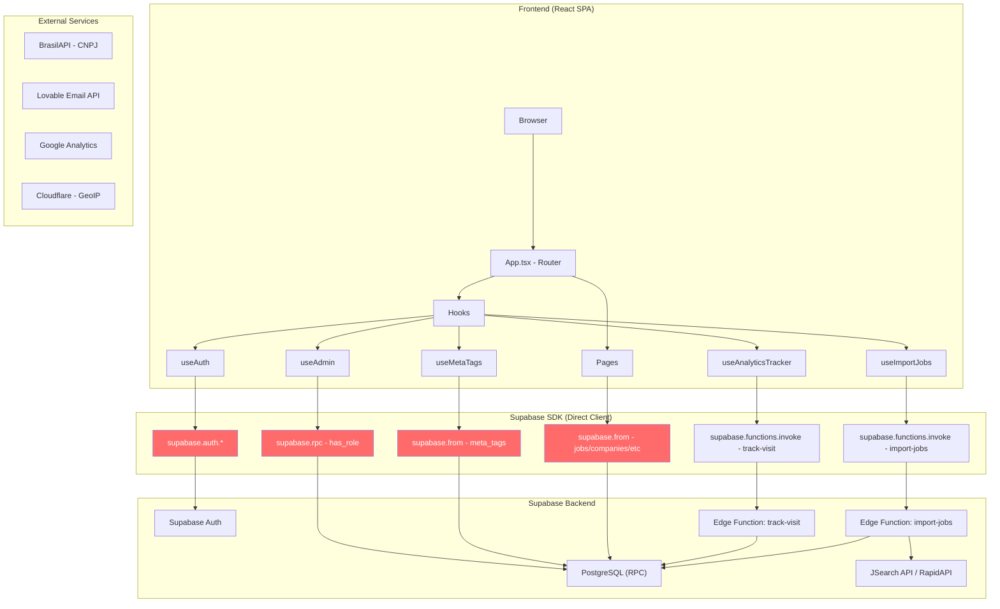
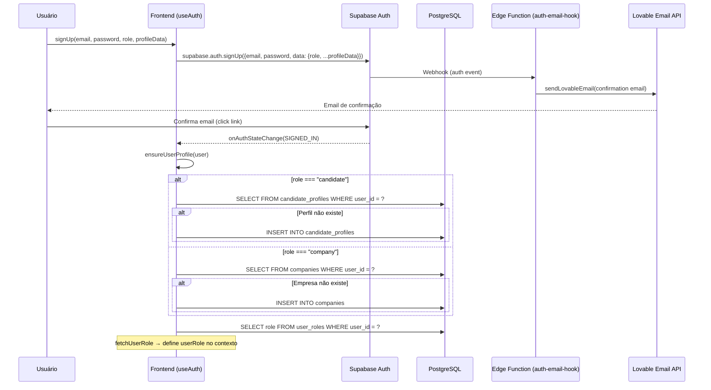
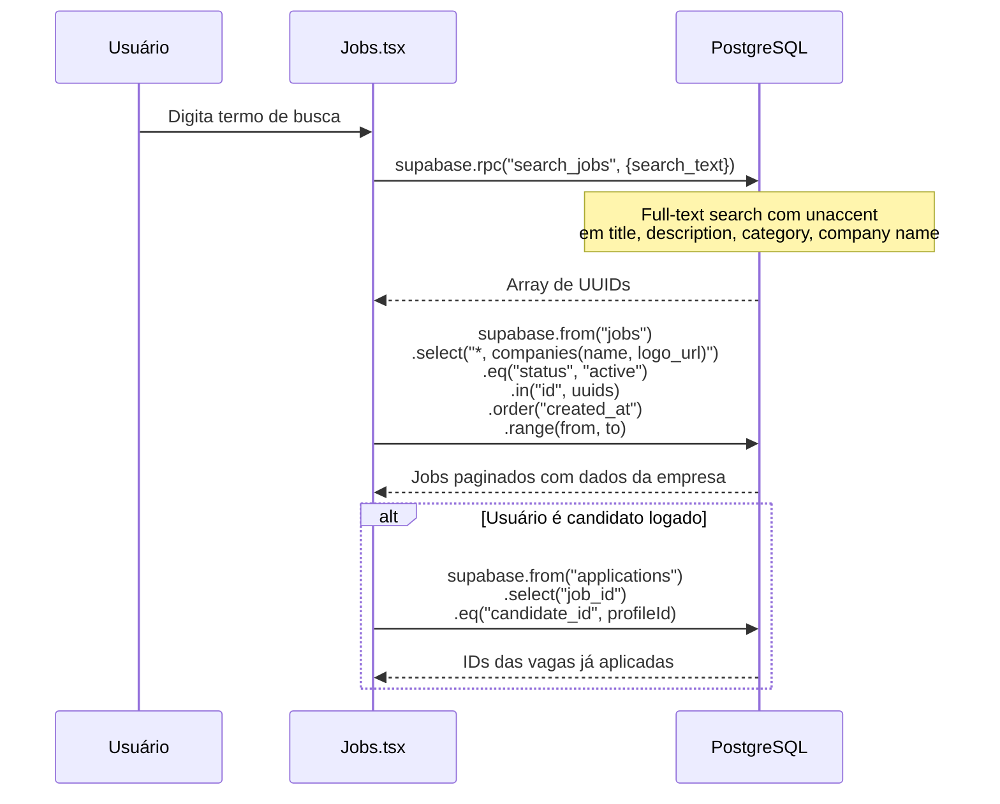
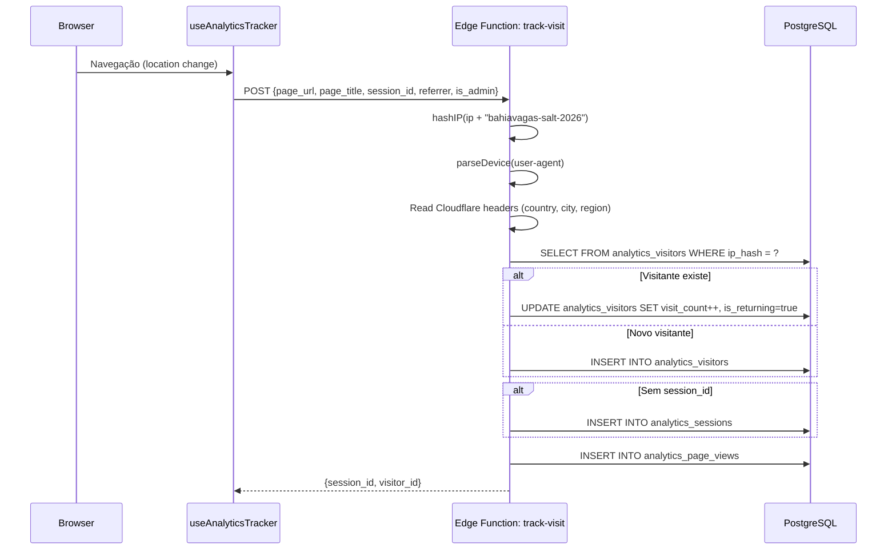
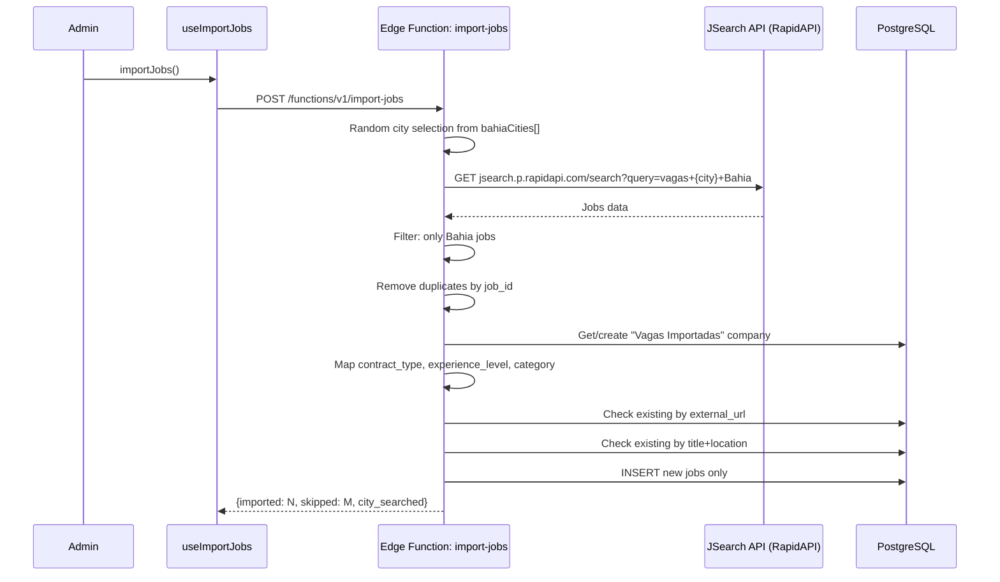
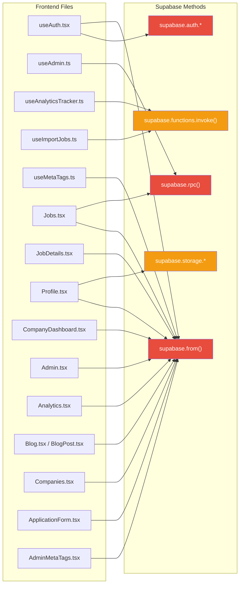

# 🔍 BahiaVagas — Análise Profunda & Plano de Migração de Backend

> **Objetivo**: Mapear 100% da codebase, identificar riscos, descobrir regras de negócio implícitas e preparar base técnica para migração a um backend próprio.

---

## 📊 Resumo Executivo

| Dimensão | Valor |
|---|---|
| **Tipo** | SPA (React 18 + Vite) com backend serverless (Supabase/Lovable) |
| **Tabelas no DB** | 10 tabelas + 3 enums |
| **Edge Functions** | 5 funções Deno |
| **Rotas frontend** | ~630 rotas (19 fixas + 10 SEO + 417 municípios + 180+ programáticas) |
| **Páginas SEO** | 607+ páginas geradas automaticamente |
| **Componentes** | ~68 (16 custom + ~50 shadcn/ui + 2 blog) |
| **Hooks customizados** | 8 |
| **Domínio** | bahiavagas.com |
| **Nível de acoplamento Supabase** | 🔴 **CRÍTICO** — comunicação direta do frontend |

---

## 🏗️ Arquitetura Atual — Mapeamento Ponta a Ponta

### Diagrama de Fluxo Geral



> [!CAUTION]
> **Os nós em vermelho representam comunicação DIRETA do frontend com o Supabase**, sem camada intermediária. Isso significa que a `anon key` está exposta no browser e toda a segurança depende exclusivamente das políticas RLS do PostgreSQL.

---

### Fluxos Críticos de Dados

#### 1. Autenticação (Auth Flow)



> [!WARNING]
> **Regra implícita**: A role do usuário é armazenada em `user_metadata` do Supabase Auth E na tabela `user_roles`. Se ficarem dessincronizadas, o sistema pode ter comportamento inconsistente. O trigger `handle_new_user_role()` deveria criar a role automaticamente, mas o frontend TAMBÉM faz a criação do perfil via `ensureUserProfile()` — **duplicação de responsabilidade**.

#### 2. Busca de Vagas (Job Search Flow)



#### 3. Analytics (Tracking Flow)



#### 4. Importação de Vagas



---

## 🔐 Auditoria de Segurança — Riscos Identificados

| # | Severidade | Risco | Localização | Descrição |
|---|---|---|---|---|
| 1 | 🔴 **CRÍTICO** | Chaves expostas no browser | [client.ts](file:///c:/Users/luis.gabriel/Documents/bahia-vagas-connect/src/integrations/supabase/client.ts) | `SUPABASE_URL` e `SUPABASE_PUBLISHABLE_KEY` estão no bundle JS. Qualquer pessoa pode fazer queries diretas ao Supabase. |
| 2 | 🔴 **CRÍTICO** | Anon key no `.env` sem proteção | [.env](file:///c:/Users/luis.gabriel/Documents/bahia-vagas-connect/.env) | Embora seja "anon key", ela permite inserções nas tabelas analytics (RLS permite `public INSERT`). |
| 3 | 🔴 **CRÍTICO** | Analytics RLS super permissivo | [Migration](file:///c:/Users/luis.gabriel/Documents/bahia-vagas-connect/supabase/migrations/20260325033924_41fb26ff-bcab-4cf7-bce3-ce388587e3bc.sql#L52-L61) | `INSERT` e `UPDATE` liberados para `public` em TODAS as tabelas analytics. Permite flood de dados falsos e manipulação de métricas. |
| 4 | 🟡 **ALTO** | Edge Functions sem autenticação | [import-jobs](file:///c:/Users/luis.gabriel/Documents/bahia-vagas-connect/supabase/functions/import-jobs/index.ts#L86-L89) | `import-jobs` não verifica JWT nem role admin. Qualquer requisição POST pode importar vagas. |
| 5 | 🟡 **ALTO** | `track-visit` sem rate limiting | [track-visit](file:///c:/Users/luis.gabriel/Documents/bahia-vagas-connect/supabase/functions/track-visit/index.ts) | Sem throttling, permite ataque de flood na tabela analytics. |
| 6 | 🟡 **ALTO** | CORS wildcard (`*`) em todas as Edge Functions | Todas as Edge Functions | `Access-Control-Allow-Origin: *` permite requisições de qualquer domínio. |
| 7 | 🟡 **ALTO** | Salt de IP hash hardcoded | [track-visit:L10](file:///c:/Users/luis.gabriel/Documents/bahia-vagas-connect/supabase/functions/track-visit/index.ts#L10) | `"bahiavagas-salt-2026"` está no código-fonte. Se exposto, permite re-hash e correlação de IPs. |
| 8 | 🟠 **MÉDIO** | `validate-cnpj` sem autenticação | [validate-cnpj](file:///c:/Users/luis.gabriel/Documents/bahia-vagas-connect/supabase/functions/validate-cnpj/index.ts) | Pode ser abusado como proxy para consultas em massa à BrasilAPI. |
| 9 | 🟠 **MÉDIO** | Queries diretas do frontend | Múltiplos arquivos | O frontend monta queries Supabase complexas diretamente. Mudanças no schema quebram o frontend. |
| 10 | 🟠 **MÉDIO** | Sem proteção contra account enumeration | [useAuth.tsx:L233](file:///c:/Users/luis.gabriel/Documents/bahia-vagas-connect/src/hooks/useAuth.tsx#L233) | O check `identities?.length === 0` revela se um email já está cadastrado. |
| 11 | 🟢 **BAIXO** | LocalStorage para vagas vistas | [useViewedJobs.ts](file:///c:/Users/luis.gabriel/Documents/bahia-vagas-connect/src/hooks/useViewedJobs.ts) | Dados não críticos, mas sem expiração (apenas limite de 500 itens). |
| 12 | 🟢 **BAIXO** | Estatísticas hardcoded na home | [Index.tsx:L211-L232](file:///c:/Users/luis.gabriel/Documents/bahia-vagas-connect/src/pages/Index.tsx#L211-L232) | "1.000+ Vagas", "500+ Empresas", "10.000+ Candidatos" são valores fixos no código, não dados reais. |

---

## 📋 Regras de Negócio Implícitas Descobertas

### Autenticação & Perfis

| # | Regra | Localização | Detalhes |
|---|---|---|---|
| 1 | **Criação de perfil dual-path** | [useAuth.tsx](file:///c:/Users/luis.gabriel/Documents/bahia-vagas-connect/src/hooks/useAuth.tsx#L62-L119) | O perfil é criado tanto pelo trigger `handle_new_user_role()` quanto pelo hook `ensureUserProfile()`. O hook faz check antes de inserir (`maybeSingle`). |
| 2 | **Admin tem role funcional** | [useAuth.tsx:L129-L134](file:///c:/Users/luis.gabriel/Documents/bahia-vagas-connect/src/hooks/useAuth.tsx#L129-L134) | Se o user é admin E tem outra role (candidate/company), o `userRole` é setado para a role funcional. Admin é verificado separadamente pelo `useAdmin`. |
| 3 | **Fallback de role por perfil** | [useAuth.tsx:L138-L161](file:///c:/Users/luis.gabriel/Documents/bahia-vagas-connect/src/hooks/useAuth.tsx#L138-L161) | Se não encontra role na `user_roles`, verifica se existe perfil em `candidate_profiles` ou `companies` como fallback. |
| 4 | **Profile check com debounce** | [useAuth.tsx:L64](file:///c:/Users/luis.gabriel/Documents/bahia-vagas-connect/src/hooks/useAuth.tsx#L64) | `profileCheckedRef` evita checagens repetidas para o mesmo user_id. Resetado em signIn, signOut e signUp. |

### Vagas & Busca

| # | Regra | Localização | Detalhes |
|---|---|---|---|
| 5 | **Full-text search com unaccent** | [Jobs.tsx:L83-L84](file:///c:/Users/luis.gabriel/Documents/bahia-vagas-connect/src/pages/Jobs.tsx#L83-L84) | Busca usa RPC `search_jobs` que faz full-text search removendo acentos. Busca em título, descrição, categoria e nome da empresa. |
| 6 | **Filtro por experience combina DB + título** | [Jobs.tsx:L117-L137](file:///c:/Users/luis.gabriel/Documents/bahia-vagas-connect/src/pages/Jobs.tsx#L117-L137) | Além de filtrar por `experience_level`, busca por keywords no título ("auxiliar", "assistente", "estágio"). |
| 7 | **Redirecionamento por município** | [Jobs.tsx:L57-L66](file:///c:/Users/luis.gabriel/Documents/bahia-vagas-connect/src/pages/Jobs.tsx#L57-L66) | Quando o filtro de location muda, verifica se é um município da Bahia e redireciona para `/vagas-{slug}`. |
| 8 | **Importação com cidade aleatória** | [import-jobs:L107](file:///c:/Users/luis.gabriel/Documents/bahia-vagas-connect/supabase/functions/import-jobs/index.ts#L107) | Cada execução busca vagas em uma cidade aleatória de uma lista de 50 cidades. |
| 9 | **Deduplicação dupla na importação** | [import-jobs:L228-L262](file:///c:/Users/luis.gabriel/Documents/bahia-vagas-connect/supabase/functions/import-jobs/index.ts#L228-L262) | Verifica duplicatas por `external_url` E por `title + location`. |
| 10 | **Empresa padrão para importação** | [import-jobs:L174-L197](file:///c:/Users/luis.gabriel/Documents/bahia-vagas-connect/supabase/functions/import-jobs/index.ts#L174-L197) | Vagas importadas são associadas a uma empresa fixa chamada "Vagas Importadas" (criada automaticamente sem `user_id`). |

### SEO & Analytics

| # | Regra | Localização | Detalhes |
|---|---|---|---|
| 11 | **SEO programático = 180+ páginas** | [seo-programmatic.ts](file:///c:/Users/luis.gabriel/Documents/bahia-vagas-connect/src/lib/seo-programmatic.ts) | Combina 10 profissões × 10 cidades × 8 tipos para gerar páginas SEO automaticamente. |
| 12 | **Detecção de Lovable.app** | [index.html](file:///c:/Users/luis.gabriel/Documents/bahia-vagas-connect/index.html) | Script injeta `noindex,nofollow` e redireciona para bahiavagas.com se acessado via lovable.app. |
| 13 | **Analytics: sessão via ref** | [useAnalyticsTracker.ts](file:///c:/Users/luis.gabriel/Documents/bahia-vagas-connect/src/hooks/useAnalyticsTracker.ts) | Session ID é mantido em `useRef`, ou seja, se o componente remonta, a sessão se perde. |
| 14 | **Meta tags dinâmicas por DB lookup** | [useMetaTags.ts](file:///c:/Users/luis.gabriel/Documents/bahia-vagas-connect/src/hooks/useMetaTags.ts) | Cada navegação faz query na tabela `meta_tags` por `page_path`. Se existir, sobrescreve título e meta tags do HTML. |
| 15 | **Canonical sempre bahiavagas.com** | [useMetaTags.ts:L44](file:///c:/Users/luis.gabriel/Documents/bahia-vagas-connect/src/hooks/useMetaTags.ts#L44) | Todas as URLs canônicas apontam para `https://bahiavagas.com{pathname}`, mesmo em dev. |

---

## 🗺️ Mapa de Dependências do Supabase

Todo ponto de acoplamento entre o frontend e o Supabase:



**Inventário de acesso direto ao Supabase:**

| Método | Tabelas Acessadas Diretamente do Frontend |
|---|---|
| `supabase.from()` | `jobs`, `companies`, `candidate_profiles`, `applications`, `user_roles`, `meta_tags`, `blog_posts`, `analytics_*` |
| `supabase.rpc()` | `has_role()`, `search_jobs()` |
| `supabase.functions.invoke()` | `track-visit`, `import-jobs`, `validate-cnpj` |
| `supabase.auth.*` | `signUp`, `signIn`, `signOut`, `getSession`, `onAuthStateChange` |
| `supabase.storage` | `resumes` bucket (upload de currículos) |

> [!IMPORTANT]
> **São 15+ arquivos** no frontend que fazem queries diretas ao Supabase. Qualquer migração de backend precisa substituir TODOS esses pontos de acesso por chamadas REST/GraphQL ao novo backend.

---

## 🏛️ Proposta de Arquitetura — Novo Backend (NestJS)

### Estrutura de Módulos Proposta

```
bahiavagas-api/
├── src/
│   ├── main.ts
│   ├── app.module.ts
│   │
│   ├── auth/                          # Substituir Supabase Auth
│   │   ├── auth.module.ts
│   │   ├── auth.controller.ts         # POST /auth/signup, /auth/signin, /auth/signout
│   │   ├── auth.service.ts            # JWT, bcrypt, role management
│   │   ├── auth.guard.ts              # JwtAuthGuard
│   │   ├── roles.guard.ts             # RolesGuard (admin, company, candidate)
│   │   ├── strategies/
│   │   │   └── jwt.strategy.ts
│   │   └── dto/
│   │       ├── signup.dto.ts
│   │       └── signin.dto.ts
│   │
│   ├── users/                         # Substituir candidate_profiles + companies + user_roles
│   │   ├── users.module.ts
│   │   ├── candidates/
│   │   │   ├── candidates.controller.ts
│   │   │   ├── candidates.service.ts
│   │   │   └── candidates.repository.ts
│   │   └── companies/
│   │       ├── companies.controller.ts
│   │       ├── companies.service.ts
│   │       └── companies.repository.ts
│   │
│   ├── jobs/                          # Substituir queries diretas
│   │   ├── jobs.module.ts
│   │   ├── jobs.controller.ts         # GET /jobs, /jobs/:id, POST /jobs
│   │   ├── jobs.service.ts            # Business logic, full-text search
│   │   ├── jobs.repository.ts         # PostgreSQL queries
│   │   ├── import/
│   │   │   ├── import.service.ts      # Substituir Edge Function import-jobs
│   │   │   └── jsearch.adapter.ts     # Integração RapidAPI
│   │   └── dto/
│   │       ├── create-job.dto.ts
│   │       └── search-jobs.dto.ts
│   │
│   ├── applications/                  # Substituir queries diretas
│   │   ├── applications.module.ts
│   │   ├── applications.controller.ts
│   │   ├── applications.service.ts
│   │   └── applications.repository.ts
│   │
│   ├── blog/                          # Substituir queries diretas
│   │   ├── blog.module.ts
│   │   ├── blog.controller.ts
│   │   └── blog.service.ts
│   │
│   ├── analytics/                     # Substituir Edge Function track-visit
│   │   ├── analytics.module.ts
│   │   ├── analytics.controller.ts    # POST /analytics/track, GET /analytics/dashboard
│   │   ├── analytics.service.ts
│   │   └── analytics.guard.ts         # Rate limiting
│   │
│   ├── seo/                           # Substituir meta_tags + sitemap Edge Function
│   │   ├── seo.module.ts
│   │   ├── sitemap.controller.ts
│   │   └── meta-tags.service.ts
│   │
│   ├── integrations/                  # Serviços externos
│   │   ├── cnpj/
│   │   │   └── cnpj.service.ts        # Substituir Edge Function validate-cnpj
│   │   └── email/
│   │       └── email.service.ts       # Substituir Lovable Email
│   │
│   ├── storage/                       # Substituir Supabase Storage
│   │   ├── storage.module.ts
│   │   └── storage.service.ts         # S3/MinIO para currículos
│   │
│   └── common/
│       ├── filters/
│       ├── interceptors/
│       ├── pipes/
│       └── decorators/
│
├── prisma/                            # ORM
│   └── schema.prisma
│
├── test/
├── Dockerfile
└── docker-compose.yml
```

### Correspondência Edge Functions → Módulos NestJS

| Edge Function | Módulo NestJS | Endpoints |
|---|---|---|
| `track-visit` | `analytics/` | `POST /api/analytics/track` |
| `import-jobs` | `jobs/import/` | `POST /api/jobs/import` (admin only) |
| `validate-cnpj` | `integrations/cnpj/` | `POST /api/cnpj/validate` |
| `sitemap` | `seo/` | `GET /api/sitemap.xml` |
| `auth-email-hook` | `integrations/email/` | Internal service (não exposto) |

### Correspondência Funções PostgreSQL → Services

| Função DB | Service NestJS | Detalhes |
|---|---|---|
| `has_role()` | `auth.service.ts` | Check via JWT claims ou DB lookup |
| `search_jobs()` | `jobs.service.ts` | Full-text search com unaccent via Prisma raw query |
| `handle_new_user_role()` | `auth.service.ts` | Criação de role integrada ao signUp |
| `update_updated_at_column()` | `@UpdatedAt()` Prisma | Decorator automático |

---

## 🚀 Roadmap de Migração — 3 Fases

### Fase 1: Fundação (2-3 semanas)
> **Meta**: Backend funcional com auth e CRUD de vagas

- [ ] Setup do projeto NestJS + Prisma + PostgreSQL
- [ ] Migração do schema Supabase para Prisma
- [ ] Implementar módulo Auth (JWT, signup, signin, roles)
- [ ] Implementar módulo Jobs (CRUD + full-text search)
- [ ] Implementar módulo Companies (CRUD)
- [ ] Adaptar frontend: substituir `supabase.auth.*` por chamadas REST
- [ ] Adaptar frontend: substituir `supabase.from("jobs")` por API calls

### Fase 2: Funcionalidades Core (2-3 semanas)
> **Meta**: Feature parity com o sistema atual

- [ ] Módulo Applications (candidaturas)
- [ ] Módulo Candidates (perfil, currículo)
- [ ] Módulo Blog (CRUD de posts)
- [ ] Módulo Analytics (tracking + dashboard)
- [ ] Módulo SEO (meta tags + sitemap)
- [ ] Importação de vagas (JSearch API)
- [ ] Validação de CNPJ
- [ ] Storage de currículos (S3/MinIO)
- [ ] Sistema de email (SendGrid/Resend)

### Fase 3: Produção & Hardening (1-2 semanas)
> **Meta**: Deploy seguro e performático

- [ ] Rate limiting e throttling
- [ ] CORS configurado para bahiavagas.com apenas
- [ ] Logging e monitoring (Sentry/Datadog)
- [ ] CI/CD pipeline
- [ ] Migração de dados do Supabase para novo PostgreSQL
- [ ] DNS cutover: frontend apontando para novo backend
- [ ] Período de dual-run (Supabase + novo backend)
- [ ] Descomissionamento do Supabase

---

## ❓ Questões Abertas — Decisões Necessárias

> [!IMPORTANT]
> Preciso da sua resposta nessas questões antes de avançar para qualquer implementação.

### 1. Escopo da Migração

- **Migração total ou parcial?** Quer substituir 100% do Supabase (incluindo Auth e Storage) ou manter Supabase Auth e só migrar as queries diretas?
- **O banco PostgreSQL atual no Supabase será mantido?** Ou vamos provisionar um novo PostgreSQL (ex: AWS RDS, Railway, Render)?

### 2. Stack do Backend

- **NestJS é a escolha confirmada?** Ou considera alternativas como Fastify puro, Express, ou outro framework?
- **ORM**: Prisma (type-safe, migrations automáticas) ou TypeORM (mais maduro com NestJS)?
- **Deploy**: Onde hospedar? VPS (DigitalOcean, Hetzner), Cloud (AWS, GCP), ou PaaS (Railway, Render, Fly.io)?

### 3. Prioridades

- **O que é mais urgente?** Segurança (fechar brechas RLS) ou independência do Lovable/Supabase?
- **O frontend deve continuar como SPA?** Ou há interesse em migrar para Next.js (SSR) para melhorar SEO (as 600+ páginas programáticas seriam renderizadas server-side)?

### 4. Dados e Continuidade

- **Existe acesso direto ao PostgreSQL do Supabase** para fazer pg_dump e migrar dados?
- **Quantos usuários e vagas existem atualmente?** Isso impacta a estratégia de migração de dados.

### 5. Email Transacional

- **Manter Lovable Email** ou migrar para serviço próprio (SendGrid, Resend, Amazon SES)?
- **Os templates de email React** devem ser preservados tal como estão?

---

## ✅ Verificação

### Como validarei a análise:
- **Manual**: Vou compartilhar este documento para sua revisão e resposta às questões abertas
- **Técnico**: Após suas decisões, criarei um `task.md` detalhado com cada passo de implementação

### Próximos passos após aprovação:
1. Criar o projeto NestJS com a estrutura proposta
2. Migrar o schema para Prisma
3. Implementar módulo por módulo, com testes
4. Adaptar o frontend arquivo por arquivo
